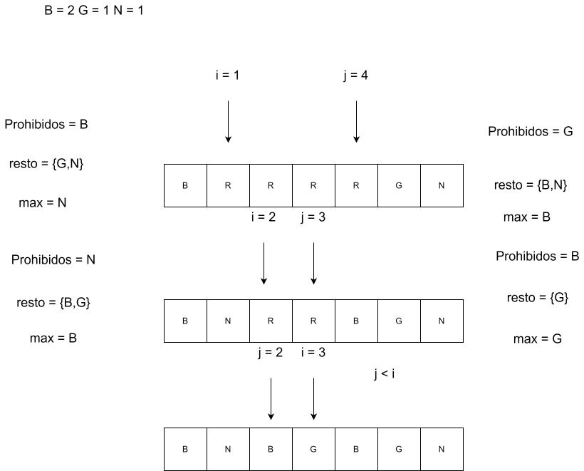

# Reconstruyendo la vereda - Greedy (óptima)

<- Volver a la [descripción del problema](../Reconstruyendo_la_vereda.md)

## Técnicas utilizadas

**Greedy:** construir la solución paso a paso, tomando en cada paso la decisión que parece mejor localmente y sin volver atrás.

## Idea de la solución

En lugar de rellenar el hueco de corrido, se lo va cerrando **desde los dos extremos hacia el centro**:

1. Se toma el extremo izquierdo del hueco (cuyo vecino ya es conocido) y se le coloca una baldosa.
2. Se toma el extremo derecho (también con vecino conocido) y se le coloca otra.
3. El hueco queda más chico, con nuevos vecinos en ambos lados: es **el mismo problema, pero con dos baldosas menos**. Se repite hasta que no quede hueco.

Para elegir el color en cada extremo se aplica el criterio ávido:

- no puede ser igual al vecino de ese lado.
- se elige el color con **más baldosas restantes**.
- en caso de empate, se prefiere el color **igual al vecino del extremo opuesto**: ese color no se podría usar del otro lado, así que conviene "gastarlo" donde sí está permitido.
- si el empate persiste, se sigue el **orden de los parámetros de entrada**: `B`, `G`, `N`.

Cuando queda una sola posición, tiene dos vecinos y el color no debe coincidir con ninguno.

> Aunque el hueco se achica en cada paso, no es división y conquista en sentido estricto: hay un único subproblema y no hay paso de combinación. Por eso se clasifica como greedy.



## Código

```python
def vereda(B, G, N, baldosas):
    i = baldosas.find('R')
    j = baldosas.rfind('R')
    izq = baldosas[i - 1] if i > 0 else ''
    der = baldosas[j + 1] if j + 1 < len(baldosas) else ''
    resto = {'B': B, 'G': G, 'N': N}
    res, turno_izq = list(baldosas), True
    while i <= j:
        if i == j:      prohibidos, opuesto = {izq, der}, None
        elif turno_izq: prohibidos, opuesto = {izq}, der
        else:           prohibidos, opuesto = {der}, izq
        cand = [c for c in resto if resto[c] > 0 and c not in prohibidos]
        # más restantes; el color del vecino opuesto; orden B, G, N
        c = max(cand, key=lambda c: (resto[c], c == opuesto))
        resto[c] -= 1
        if i == j or turno_izq: res[i] = c; izq = c; i += 1
        else:                   res[j] = c; der = c; j -= 1
        turno_izq = not turno_izq
    return ''.join(res)
```

## Traza de ejemplo

Entrada: `2 2 2` y `BGRRRRRRBNGB`. El hueco ocupa las posiciones 0 a 5 (relativas al hueco), vecino izquierdo `G`, vecino derecho `B`.

| Paso | Extremo | Vecino | Restantes (B,G,N) | Candidatos | Elegido | Motivo |
|------|---------|--------|-------------------|------------|---------|--------|
| 1 | izq (pos 0) | G | 2,2,2 | B, N | **B** | empate. `B` es el vecino del extremo opuesto |
| 2 | der (pos 5) | B | 1,2,2 | G, N | **G** | empate. ninguno es el opuesto (`B`), se toma el primero disponible|
| 3 | izq (pos 1) | B | 1,1,2 | G, N | **N** | `N` tiene más restantes |
| 4 | der (pos 4) | G | 1,1,1 | B, N | **N** | empate. `N` es el vecino del extremo opuesto |
| 5 | izq (pos 2) | N | 1,1,0 | B, G | **B** | empate. ninguno es el opuesto (`N`), se toma el primero disponible|
| 6 | centro (pos 3) | B y N | 0,1,0 | G | **G** | único color posible |

Relleno: `BNBGNG`. Resultado: `BG` + `BNBGNG` + `BNGB` = `BGBNBGNGBNGB`. No hay repetidos contiguos, los bordes `G|B` y `G|B` son correctos y usa 2 `B`, 2 `G` y 2 `N`. Es una de las 14 salidas válidas.

## Complejidad

- **Tiempo:** `O(n)`. Una pasada para ubicar el hueco y luego `k` pasos de trabajo constante (a lo sumo 3 candidatos). Como `k ≤ n`, el total es lineal.
- **Espacio:** `O(n)` por la lista de salida, la memoria auxiliar adicional es `O(1)`, ya que solo se guardan los contadores y los dos vecinos.

## Cuándo usar esta técnica

- **Favorable:** cuando hay una regla local simple que no compromete el resto y `n` es grande. Es la única de las tres soluciones que entra en tiempo con 2.000.000 de baldosas.
- **Limitaciones:** su corrección depende del criterio de desempate y requiere justificación o validación; un criterio distinto puede fallar en los bordes. Si el problema se complicara (varios tramos relacionados, restricciones nuevas), podría dejar de ser correcto.
- **Comparación:** frente a la [fuerza bruta](Reconstruyendo_la_vereda-fuerza-bruta.md) pasa de `O(k · 3^k)` a `O(k)`, y frente al [backtracking](Reconstruyendo_la_vereda-backtracking.md) (`O(2^k)` en el peor caso) elimina la exploración y la vuelta atrás. A cambio, no ofrece la garantía "evidente" de las otras dos.
